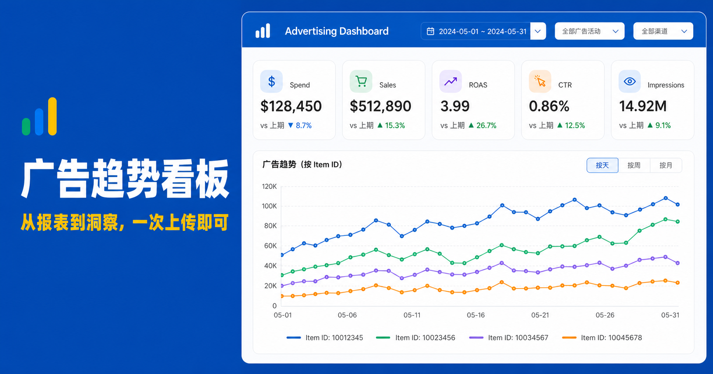
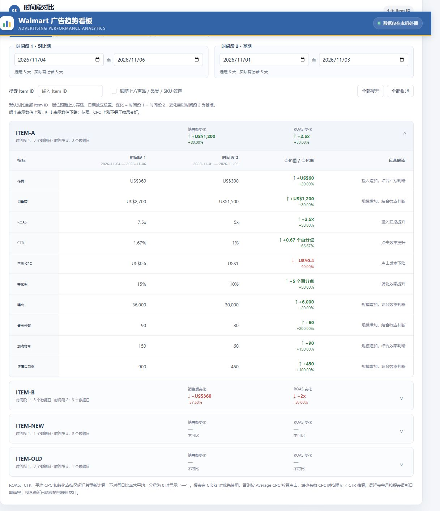
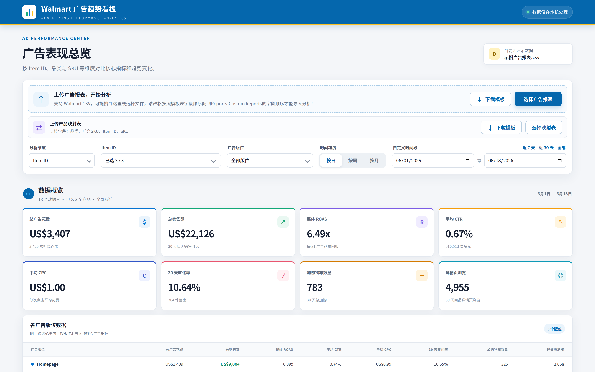
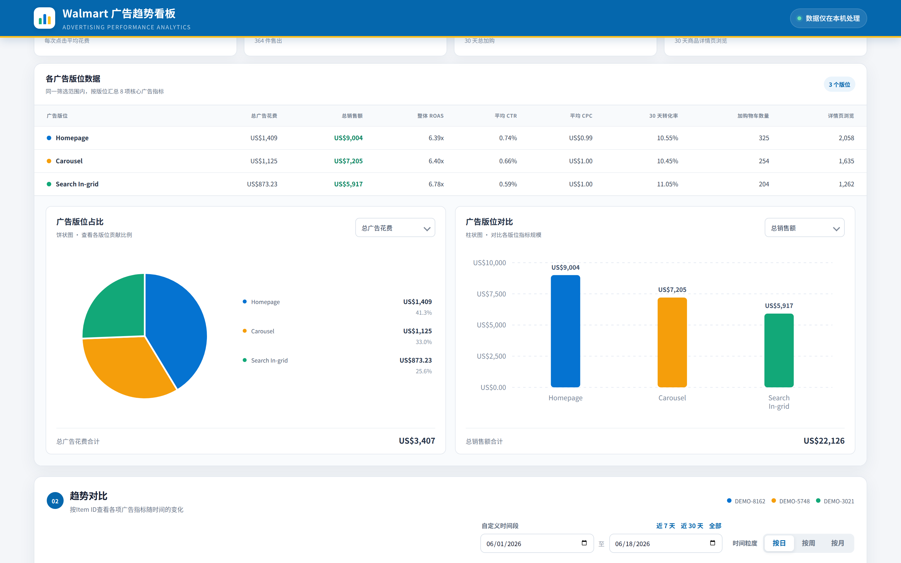
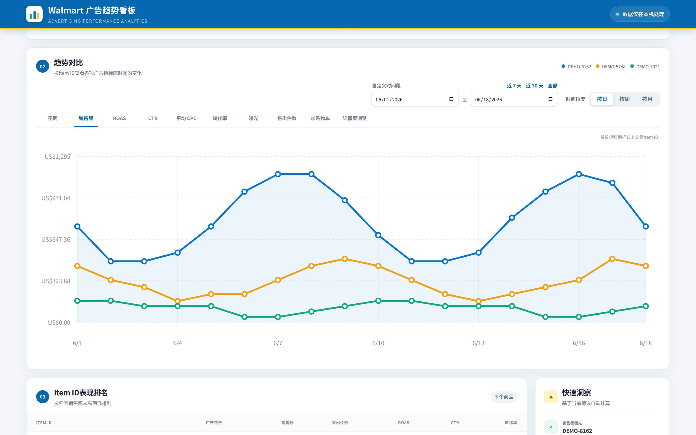
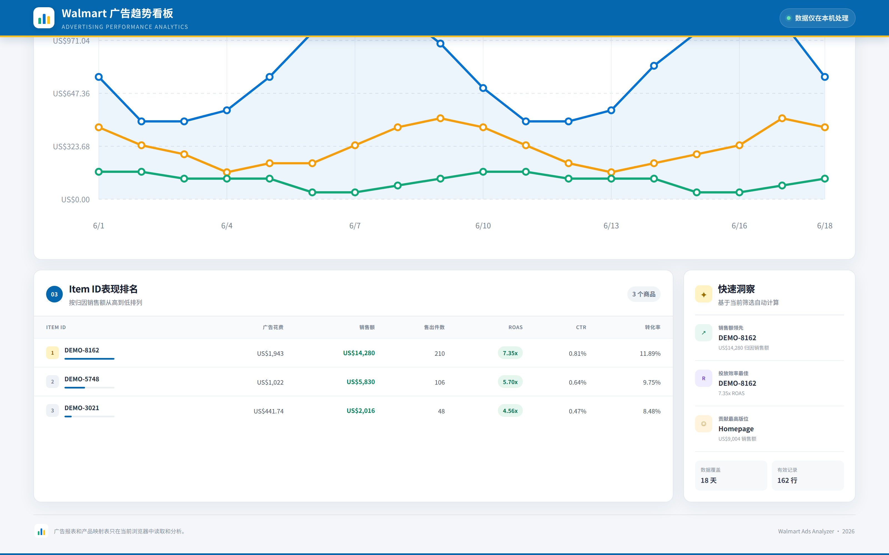
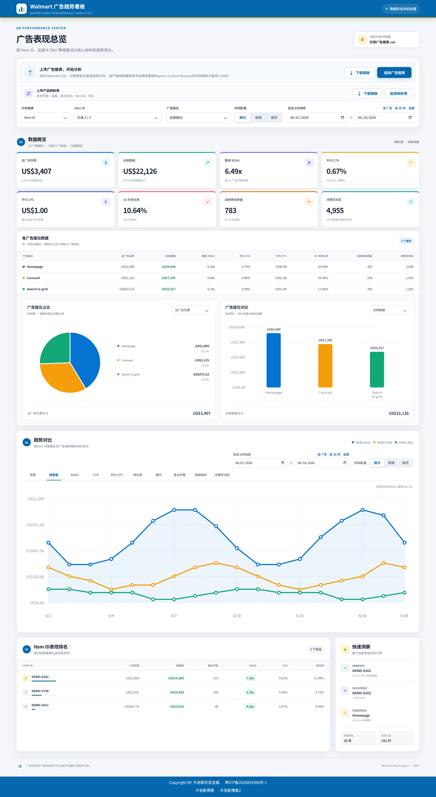
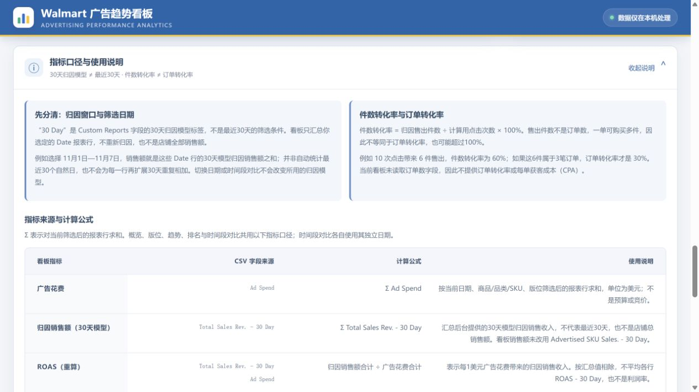

<p align="center">
  
</p>

<h1 align="center">Walmart 广告趋势看板 · Walmart Ads Trends</h1>

<p align="center">
  <b>上传 Walmart 广告报表，一次看清花费、销售额与 ROAS 的趋势</b><br>
  免费开源的 Walmart 广告分析看板，数据只在你的浏览器里处理<br>
  <sub>A free, open-source dashboard for Walmart ad spend, sales and ROAS trends — processed locally in your browser.</sub>
</p>

<p align="center">
  <a href="https://github.com/CALOS985/walmart-ads-trends/releases/latest"></a>
  
  <a href="LICENSE"></a>
  
</p>

<p align="center">
  <a href="https://carloswiki.com/Walmart%20Trends/">🌐 在线演示 Live Demo</a> ·
  <a href="https://github.com/CALOS985/walmart-ads-trends/releases/latest">⬇️ 下载 Download</a> ·
  <a href="#screenshots">🖼️ 截图 Screenshots</a> ·
  <a href="#report-format-zh">📋 模板 Templates</a> ·
  <a href="#deploy-zh">🚀 部署 Deploy</a> ·
  <a href="#english">English</a>
</p>

<p align="center">
  
</p>

---

## 中文

### 这是什么

Walmart 广告趋势看板是一个纯静态的单页应用。打开页面，上传两份 CSV 就能开始分析：

1. **广告报表**：从 Walmart 后台 Reports → Custom Reports 导出的报表
2. **产品映射表（可选）**：把 Item ID 对应到你自己的品类、后台 SKU 与 SKU

打开即用，不用注册、不用装 Node.js、不用连服务器。报表和映射表只在当前浏览器中读取和分析，不会上传到任何地方。

> 首次打开默认显示内置演示数据（示例广告报表.csv，2026 年 6 月 1 日—6 月 18 日，18 个数据日、3 个商品、162 行有效记录），上传自己的报表后会自动替换为你的数据。

### 三步上手

1. 到 Walmart 后台 **Reports → Custom Reports**，参考[模板字段名称](#report-format-zh)导出广告报表 CSV。
2. 打开[在线演示](https://carloswiki.com/Walmart%20Trends/)，点 **选择广告报表** 上传 CSV；想按品类 / 后台 SKU 分析，再上传一份产品映射表。
3. 在页面上选 Item ID、广告版位和时间范围，直接看数据概览、版位对比、趋势图和表现排名。

### 能做什么

|  | 功能 | 一句话说明 |
| --- | --- | --- |
| 📤 | 上传广告报表 | 支持拖拽或选择 Walmart CSV；按字段名称自动识别；CSV 列顺序可调整 |
| 🗺️ | 上传产品映射表 | 字段：品类、后台 SKU、Item ID、SKU；上传后可按品类 / 后台 SKU / SKU 维度分析 |
| 📊 | 数据概览 | 8 张 KPI 卡片：总广告花费、归因销售额（30天模型）、整体 ROAS、平均 CTR、平均 CPC、件数转化率、加购物车数量、详情页浏览 |
| 🧩 | 各广告版位数据 | Homepage、Carousel、Search In-grid 三个版位，各汇总 8 项核心指标；另有版位占比饼状图与版位对比柱状图 |
| 📈 | 趋势对比 | 花费、销售额、ROAS、CTR、平均 CPC、件数转化率、曝光、售出件数、加购物车、详情页浏览共 10 个指标，按日 / 按周 / 按月看折线变化 |
| 🏆 | 表现排名 | 按归因销售额从高到低排列每个 Item ID：花费、销售额、售出件数、ROAS、CTR、件数转化率 |
| 💡 | 快速洞察 | 基于当前筛选自动计算：销售额领先、投放效率最佳、贡献最高版位、数据覆盖天数与有效记录数 |
| 🗓️ | 时间筛选 | 自定义时间段，另有近 7 天、近 30 天、全部快捷按钮 |
| 🔄 | 时间段对比 | 在 Item ID 表现排名上方，近 3 / 7 / 30 天及完整自然月快捷对比，也可自选两个区间；按 Item ID 展开 10 项指标的两个区间数值、差值与变化率 |
| 🔒 | 本地处理 | 广告报表和产品映射表只在当前浏览器中读取和分析，不上传服务器 |

<a id="screenshots"></a>

### 截图 · Screenshots

原有模块截图使用内置演示数据，新增时间段对比截图使用合成样例报表展示涨跌和缺失区间；均非真实业务数据。部署新版 ZIP 后可使用 V1.2.0 功能。

**时间段对比（V1.2.0）**



**上传区与数据概览**



演示数据示例：总广告花费 US$3,407（3,420 次计算用点击）、总销售额 US$22,126（30天模型归因销售收入）、整体 ROAS 6.49x、平均 CTR 0.67%（510,513 次曝光）、平均 CPC US$1.00、件数转化率 10.64%（364 件售出）、加购物车 783、详情页浏览 4,955。

**各广告版位数据**



演示数据示例：Homepage 花费 US$1,409、销售额 US$9,004、ROAS 6.39x；Carousel 花费 US$1,125、销售额 US$7,205、ROAS 6.40x；Search In-grid 花费 US$873.23、销售额 US$5,917、ROAS 6.78x。饼状图按花费占比：Homepage 41.3%、Carousel 33.0%、Search In-grid 25.6%。

**趋势对比**



默认指标为销售额，按日查看 6 月 1 日—6 月 18 日三条 Item ID 折线；另有花费、ROAS、CTR、平均 CPC、件数转化率、曝光、售出件数、加购物车、详情页浏览共 10 个指标页签。

**表现排名与快速洞察**



演示数据示例：第 1 名 DEMO-8162，花费 US$1,943、销售额 US$14,280、售出 210 件、ROAS 7.35x；第 2 名 DEMO-5748，销售额 US$5,830、ROAS 5.70x；第 3 名 DEMO-3021，销售额 US$2,016、ROAS 4.56x。

**整页总览**



<a id="report-format-zh"></a>

### 报表格式要求

页面提供模板下载（`templates/` 目录下也有同款文件），**按字段名称自动识别，列顺序可以自由调整；请保留模板字段名称。缺失必需字段或存在重复字段时会显示明确提示。**。

**广告报表模板字段**（`templates/ads-report-template.csv`）：

| 模板序号（可调整） | 字段 |
| --- | --- |
| 1 | Date |
| 2 | Item Id |
| 3 | Placement |
| 4 | Impressions |
| 5 | Ad Spend |
| 6 | CTR |
| 7 | Average CPC |
| 8 | Total Units Sold - 30 Day |
| 9 | Conversion Rate - 30 Day |
| 10 | ROAS - 30 Day |
| 11 | Advertised SKU Sales. - 30 Day |
| 12 | Total Sales Rev. - 30 Day |
| 13 | Advertised Add to Cart - 30 Day |
| 14 | Advertised Product Detail Page Views - 30 Day |
| 15 | Total Add to Cart - 30 Day |

**产品映射表模板字段**（`templates/product-mapping-template.csv`）：品类、后台 SKU、Item ID、SKU。映射表里不能有重复的 Item ID。

<a id="deploy-zh"></a>

### 部署 · Deploy

这是一个已构建好的静态站，**不用安装 Node.js，不用运行 pnpm**，任何静态 Web 服务器都能跑。

**GitHub Pages（推荐）**

1. 把本仓库推到 GitHub。
2. 打开仓库 **Settings → Pages**，Source 选 **Deploy from a branch**，Branch 选 `main`、目录选 `/ (root)`，保存。
3. 访问 `https://CALOS985.github.io/walmart-ads-trends/`，请用带末尾斜杠的目录网址访问。

**任意静态服务器**

1. 把仓库文件上传到服务器的网站目录（如 `Walmart Trends`）。
2. 解压后 `index.html`、`assets/`、`templates/`、`favicon.png`、`favicon.svg`、`og.png` 应直接位于该目录内，不要额外套一层同名子文件夹。
3. 访问对应网址并按 `Ctrl+F5` 强制刷新；如果仍显示旧页面，清除该网址的服务器或 CDN 页面缓存后重试。

### 时间段对比的计算规则

- 位置：趋势对比之后、Item ID 表现排名之前。默认对比全部 Item ID，可搜索、全部展开 / 收起，也可选择跟随上方商品 / 品类 / SKU 筛选；版位筛选始终生效。
- 近 3 / 7 / 30 天以报表最新日期为末日，包含当天，与紧邻的前 3 / 7 / 30 天比较。完整月比较最新已结束的自然月与其前一个月。
- 自定义时间段 1 是对比期，时间段 2 是基期；开始和结束日期都计入。该区间独立于页面顶部和趋势图日期。
- 差值 = 时间段 1 − 时间段 2；变化率 = 差值 ÷ 基期绝对值。基期为 0、对比期不为 0 时不显示无限大变化率。
- 上涨用绿色 ↑，下跌用红色 ↓，持平灰色。CTR / 件数转化率的绝对变化单位为“百分点”。绿色仅表示数值增加；花费和 CPC 会附带成本解读。
- 比率使用区间汇总数据重算。Clicks 存在时优先使用实际点击；否则按 Average CPC 折算，缺少有效 CPC 时使用曝光 × CTR。分母为 0 时显示“—”。
- 任一区间没有该 Item 记录时显示“无数据”，不把它当作 0 计算涨跌；区间覆盖不足、天数不同或重叠均有提示。

### 指标口径与使用说明

页面底部新增同名折叠说明，概览提示和卡片ⓘ可直接打开。完整文字见 [指标口径文档](docs/METRICS.md)。

- “30 Day”是后台归因模型，不是最近30天筛选；Date范围决定汇总哪些报表行。
- 件数转化率 = 归因售出件数 ÷ 计算用点击次数 × 100%，不等同于订单转化率，可能超过100%。
- 表内逐项列明字段来源、汇总公式、点击折算/估算方式、加购回退和零分母处理。



### 下载与源码

- **直接部署**：到 [Releases](https://github.com/CALOS985/walmart-ads-trends/releases/latest) 下载 `walmart-ads-trends-v1.2.3-static.zip`，解压到网站目录即可。发行页面另附 SHA-256 校验文件。
- **修改功能**：React / TypeScript 原始代码在 [`source/`](source/)，环境、构建与重新打包方法见 [开发说明](docs/DEVELOPMENT.md)。
- **下载模板**：[广告报表模板](templates/ads-report-template.csv) · [产品映射表模板](templates/product-mapping-template.csv)。

### 目录结构

```
walmart-ads-trends/
├── index.html                  # 入口页面
├── assets/
│   ├── index-*.js              # 应用代码（已构建）
│   └── index-*.css             # 样式（已构建）
├── templates/
│   ├── ads-report-template.csv       # 广告报表模板
│   └── product-mapping-template.csv  # 产品映射表模板
├── docs/images/screenshots/   # README 截图（PNG）
├── source/                    # 可编辑的 React / TypeScript 源码
├── scripts/                   # 文件检查与静态发行包脚本
├── .github/ISSUE_TEMPLATE/    # 故障反馈与功能建议表单
├── CHANGELOG.md               # 更新记录
├── THIRD_PARTY_NOTICES.md      # 第三方运行时许可
├── favicon.png                  # 浏览器标签图标
├── favicon.svg
├── og.png                      # 分享封面图
├── LICENSE
└── README.md
```

### 最近更新

**V1.2.3（2026-11-10）**

- 上传提示补充：可从网站下载模板，并参照示例配置和保存沃尔玛广告后台 Custom Reports 字段模板。


**V1.2.2（2026-11-10）**

- 新增页脚折叠式指标说明及卡片入口，区分30天归因模型、筛选日期和件数/订单转化率；统一相关标签，计算公式保持不变。


**V1.2.1（2026-11-09）**

- 浏览器标签图标更换为本地 PNG 图标，源码和静态部署包同步更新。


**V1.2.0（2026-11-09）**

- 新增时间段对比：3 / 7 / 30 天、完整自然月和两个自定义区间。
- 每个 Item ID 可展开花费、销售额、ROAS、CTR、平均 CPC、件数转化率、曝光、售出件数、加购物车、详情页浏览。
- 显示两个时间段的数值、差值、变化率、红绿箭头与运营解读，并处理无数据、零基期和区间覆盖提示。
- CSV 按字段名自动识别，列顺序可调整；新增缺失和重复字段校验，支持实际 Clicks。

首次 GitHub 发布为 V1.1.0（2026-11-08）。完整历史见 [CHANGELOG.md](CHANGELOG.md)。

### 常见问题

**上传后提示“未找到 Date 和 Item Id 字段”？**

请确认上传的是 Walmart 广告报表 CSV，且表头包含 `Date`、`Item Id` 等必需字段；列顺序不需要与模板一致。缺失或重复字段会在页面提示。

**上传后提示“已找到表头，但没有识别到有效的数据行”？**

表头对了，但没有可用的数据行。请检查报表时间范围与内容是否为空，或重新按模板导出一份。

**映射表上传失败？**

映射表需要包含品类、后台 SKU、Item ID、SKU 四个字段，且 Item ID 不能重复。没有上传映射表时，品类 / 后台 SKU / SKU 分析维度不可用，只能按 Item ID 分析。

**我的数据会被上传吗？**

不会。广告报表和产品映射表只在当前浏览器中读取和分析，关闭页面即消失；换台电脑需要重新上传。

**打开还是旧页面？**

按 `Ctrl+F5` 强制刷新；还不行就清除该网址的服务器或 CDN 页面缓存。部署时请确认用新包的 `index.html` 覆盖了旧文件。

### 反馈

- 故障与需求：请在 [GitHub Issues](https://github.com/CALOS985/walmart-ads-trends/issues/new/choose) 提交，附上版本号（V1.2.0）与复现步骤；涉及报表内容的问题请先去掉真实 Item ID 与金额再贴。
- 使用问题：请在 [Discussions](https://github.com/CALOS985/walmart-ads-trends/discussions) 提问。

### 许可证 · License

MIT License，见 [LICENSE](LICENSE)。

---

<a id="english"></a>

## English

### What is it

Walmart Ads Trends is a purely static single-page app. Open the page, upload two CSV files, and start analyzing:

1. **Ads report**: exported from Walmart Seller Center, Reports → Custom Reports
2. **Product mapping (optional)**: maps each Item ID to your own category, backend SKU and SKU

No sign-up, no Node.js, no server. Your report and mapping files are read and analyzed only in your current browser — nothing is uploaded anywhere.

> On first open it shows built-in demo data (sample ads report, Jun 1–18, 2026: 18 days, 3 items, 162 valid rows). Uploading your own report replaces it with your data.

### Get started

1. In Walmart Seller Center, go to **Reports → Custom Reports** and export an ads report CSV using the field names in the [template](#report-format); column order may vary.
2. Open the [live demo](https://carloswiki.com/Walmart%20Trends/), click **选择广告报表 (Select ads report)** and upload the CSV. To analyze by category / backend SKU, upload a product mapping file too.
3. Pick Item IDs, placements and a date range, then read the overview, placement comparison, trend chart and ranking.

### What it does

|  | Feature | In one line |
| --- | --- | --- |
| 📤 | Upload ads report | Drag-and-drop or pick a Walmart CSV; columns are matched by header name and can be reordered |
| 🗺️ | Upload product mapping | Fields: category, backend SKU, Item ID, SKU; enables category / backend SKU / SKU analysis |
| 📊 | Overview | 8 KPI cards: total ad spend, total sales (30-day attribution), overall ROAS, average CTR, average CPC, unit-based conversion rate, add-to-cart, product detail page views |
| 🧩 | Placement breakdown | Homepage, Carousel and Search In-grid, each with 8 core metrics; plus a placement share pie chart and a comparison bar chart |
| 📈 | Trend comparison | 10 metrics (spend, sales, ROAS, CTR, average CPC, unit-based conversion rate, impressions, units sold, add-to-cart, PDP views) as line charts, by day / week / month |
| 🏆 | Performance ranking | Every Item ID ranked by attributed sales: spend, sales, units sold, ROAS, CTR, unit-based conversion rate |
| 💡 | Quick insights | Auto-computed for the current filter: sales leader, best efficiency, top contributing placement, data coverage |
| 🗓️ | Date filter | Custom range, plus Last 7 days / Last 30 days / All shortcuts |
| 🔄 | Period comparison | Compare 3 / 7 / 30-day periods, complete calendar months or two custom ranges; expand each item to see all 10 metrics, absolute changes and percentage changes |
| 🔒 | Local only | Reports and mapping files are read and analyzed only in your browser |

### Report format

Templates are downloadable from the page and included in `templates/`. **Columns are matched by normalized header name, regardless of order. Keep the template field names; missing required or duplicate headers produce an error.**

**Ads report template** (`templates/ads-report-template.csv`): Date, Item Id, Placement, Impressions, Ad Spend, CTR, Average CPC, Total Units Sold - 30 Day, Conversion Rate - 30 Day, ROAS - 30 Day, Advertised SKU Sales. - 30 Day, Total Sales Rev. - 30 Day, Advertised Add to Cart - 30 Day, Advertised Product Detail Page Views - 30 Day, Total Add to Cart - 30 Day.

**Product mapping template** (`templates/product-mapping-template.csv`): category, backend SKU, Item ID, SKU. Item IDs must not repeat.

### Deploy

This is a pre-built static site. **No Node.js, no `pnpm` needed** — any static web server works.

**GitHub Pages (recommended)**

1. Push this repo to GitHub.
2. Open **Settings → Pages**, set Source to **Deploy from a branch**, Branch to `main`, folder to `/ (root)`, and save.
3. Visit `https://CALOS985.github.io/walmart-ads-trends/` (use the directory URL with a trailing slash).

**Any static server**

1. Upload the repo files to the site directory (e.g. `Walmart Trends`).
2. After extracting, `index.html`, `assets/`, `templates/`, `favicon.png`, `favicon.svg` and `og.png` should sit directly in that directory — no extra same-name subfolder.
3. Visit the URL and hard-refresh with `Ctrl+F5`; if the old page still shows, clear the server / CDN page cache for that URL.

### What's new

**V1.2.3 (2026-11-10)**

- Expanded the upload hint to explain downloading a template and saving a matching Custom Reports field configuration.


**V1.2.2 (2026-11-10)**

- Added a collapsible footer guide with CSV metric sources, formulas and caveats. Attribution windows are distinguished from selected dates; conversion is clearly unit-based, not order-based. Calculations are unchanged.


**V1.2.1 (2026-11-09)**

- Replaced the browser tab icon with the supplied PNG, bundled locally for static hosting.


**V1.2.0 (2026-11-09)**

- Added per-item period comparisons above the ranking: 3 / 7 / 30 days, complete calendar months and custom date ranges.
- All 10 metrics show both period values, absolute deltas and relative changes; green ↑ / red ↓ indicate numeric direction, with cost and efficiency interpretations.
- Ratios use aggregate totals. Missing periods, zero baselines, incomplete coverage, overlapping or unequal ranges are handled explicitly.
- CSV headers can appear in any order; required and duplicate headers are validated. Actual Clicks take priority over estimates.

### FAQ

**"Date and Item Id fields not found" after upload?**

Make sure the file is a Walmart ads report CSV whose header contains `Date` and `Item Id`, with the required template field names. Columns can be in any order.

**"Header found, but no valid data rows"?**

The header is right but there are no usable rows. Check that the report's date range is not empty, or re-export it from the template.

**Mapping upload fails?**

The mapping must contain category, backend SKU, Item ID and SKU, with no duplicate Item IDs. Without a mapping, only the Item ID dimension is available.

**Is my data uploaded?**

No. Reports and mapping files are read and analyzed only in your browser and gone when you close the page.

### Download and development

- Download `walmart-ads-trends-v1.2.3-static.zip` from [Releases](https://github.com/CALOS985/walmart-ads-trends/releases/latest) for direct static hosting.
- Editable React / TypeScript files are in [`source/`](source/). See [development instructions](docs/DEVELOPMENT.md) for building and packaging.
- First GitHub release: 2026-11-08 (V1.1.0). Current version: V1.2.3 (2026-11-10).

### Feedback

- Bugs and feature requests: please open a [GitHub Issue](https://github.com/CALOS985/walmart-ads-trends/issues/new/choose) with the version (V1.2.0) and steps to reproduce. Remove real Item IDs and amounts before pasting report content.
- Usage questions: please use [Discussions](https://github.com/CALOS985/walmart-ads-trends/discussions).

### License

MIT License. See [LICENSE](LICENSE).

---

Copyright BY 卡洛斯的百宝箱 · 粤ICP备2026054366号-1
